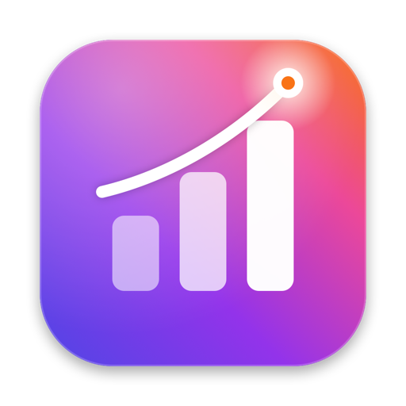
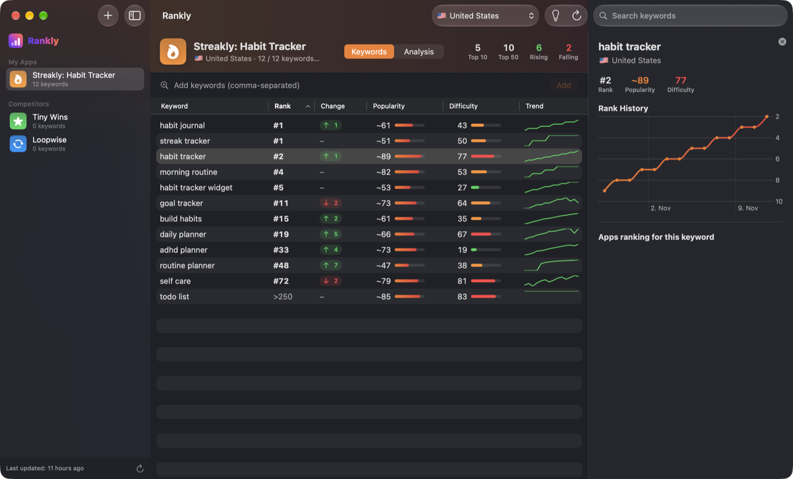

<p align="center">
  
</p>

<h1 align="center">Rankly</h1>

<p align="center">
  Free, open-source App Store keyword rank tracker and ASO analysis for macOS.<br>
  <a href="https://rankly.ardasnturk.com">Website</a> ·
  <a href="https://rankly.ardasnturk.com/guide.html">User guide</a> ·
  <a href="https://rankly.ardasnturk.com/privacy.html">Privacy</a> ·
  <a href="README.tr.md">Türkçe</a>
</p>

<p align="center">
  
</p>

## Features

- **Daily keyword rank tracking**: add any iPhone app by name, App Store ID or link, add keywords, and Rankly checks the real App Store search results (top 250) once a day in 53 countries. History chart, change since yesterday and trend sparkline for every keyword.
- **Popularity and difficulty**: popularity (~5–100) is an *estimate* from App Store autocomplete, not Apple's Search Ads score. Difficulty (0–100) reflects how established the top-10 apps are and how many target the term in their name.
- **Competitors**: see every app ranking for a keyword and track any of them in one click.
- **Keyword suggestions** from App Store autocomplete.
- **Automatic ASO analysis**: candidate keywords are extracted from the app's name, subtitle and description, then searched. You get the keywords you rank for, name/subtitle words you don't rank for, automatically discovered competitors, *opportunity* keywords competitors rank for but you don't (brand searches filtered out), and a suggested 100-character keyword field.
- **Multi-country analysis**: reads the languages your app is localized in, pre-selects the storefronts that search in those languages and analyzes each with its localized metadata in the background.
- **Menu bar extra** with top movers and ranks; Rankly keeps refreshing when the main window is closed.
- **Native design** tinted with colours extracted from each tracked app's icon.
- **10 languages**: English, Deutsch, Español, Français, Italiano, 日本語, 한국어, Português (Brasil), Türkçe, 简体中文.
- **Automatic updates** via [Sparkle](https://sparkle-project.org).
- **Private by design**: no account, no analytics, no server. Everything is stored on your Mac.

> Apple never publishes an app's hidden keyword field. Rankly instead finds the keywords an app **actually ranks for**.

## Install

Download `Rankly.dmg` from the [latest release](https://github.com/ardasnturk/rankly/releases/latest), open it and drag Rankly to Applications. Requires macOS 14 Sonoma or later (Apple silicon or Intel). Builds are signed with Developer ID and notarized by Apple.

## Build from source

```bash
brew install xcodegen
xcodegen generate
open Rankly.xcodeproj
```

Run the `Rankly` scheme. Launch with `-demo` to use an in-memory store with sample data (no network), and `-demo -demoMenuBar` to show the menu bar panel in a window.

### Project layout

| Path | What |
| --- | --- |
| `Rankly/` | SwiftUI + SwiftData app (`AppStoreClient`, `KeywordAnalyzer`, `RankRefresher`, views) |
| `Rankly/Localizable.xcstrings` | String Catalog (generated, see below) |
| `scripts/l10n/` | Translations (`<lang>.json`), `sync.py` (catalog), `extract_site.py` (website strings) |
| `scripts/make-icon.swift`, `make-menubar-icon.swift`, `make-dmg-background.swift` | Artwork rendered from code |
| `scripts/sign-app.sh`, `build-dmg.sh`, `release.sh` | Signing, DMG and release pipeline |
| `docs/` | Website (GitHub Pages, `rankly.ardasnturk.com`) and Sparkle `appcast.xml` |

### Localization

App strings live in `Rankly/Localizable.xcstrings`. After changing UI text, build the Debug configuration once and run `python3 scripts/l10n/sync.py`: it adds new keys, removes stale ones, merges `scripts/l10n/<lang>.json` and reports missing translations. Website strings are in `docs/*.html` (English) and `docs/assets/i18n/<lang>.js`; `python3 scripts/l10n/extract_site.py` writes the English source list to `scripts/l10n/site-en.json`.

### Releasing

`scripts/release.sh` builds a universal Release, signs it (including Sparkle's helpers), creates the styled DMG, notarizes and staples it, and adds the version to `docs/appcast.xml`. Then tag `v<version>` and attach `dist/Rankly.dmg` to a GitHub release.

## Data sources

Rankly uses Apple's public but undocumented App Store endpoints: `search.itunes.apple.com` (search ranking and autocomplete) and `itunes.apple.com` (lookup). Ranks reflect iPhone App Store search. If Apple changes these endpoints, `AppStoreClient.swift` needs an update.

Requests are paced (1.5 s apart for search). If Apple temporarily blocks search (HTTP 403), Rankly pauses for an hour and doubles the spacing (up to 8 s). An interrupted multi-country analysis can be resumed.

Rankly is not affiliated with Apple. App Store is a trademark of Apple Inc.

## License

[MIT](LICENSE) © 2026 Arda Sentürk
