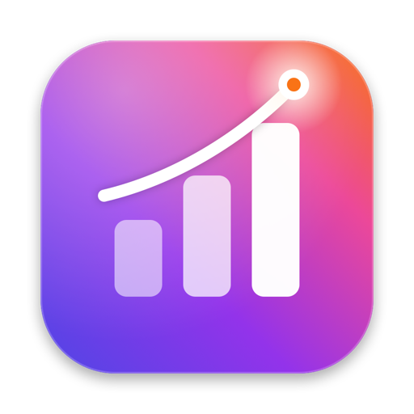

<p align="center">
  
</p>

<h1 align="center">Rankly</h1>

<p align="center">
  macOS için ücretsiz ve açık kaynaklı App Store anahtar kelime sıra takibi ve ASO analizi.<br>
  <a href="https://rankly.ardasnturk.com">Web sitesi</a> ·
  <a href="https://rankly.ardasnturk.com/guide.html">Kullanım kılavuzu</a> ·
  <a href="https://rankly.ardasnturk.com/privacy.html">Gizlilik</a> ·
  <a href="README.md">English</a>
</p>

## Özellikler

- **Günlük sıra takibi**: Herhangi bir iPhone uygulamasını adı, App Store ID'si veya linkiyle ekle, kelimelerini gir; Rankly 53 ülkede gerçek App Store arama sonuçlarını (ilk 250) her gün kontrol eder. Her kelime için geçmiş grafiği, dünden bugüne değişim ve trend çizgisi.
- **Popülerlik ve zorluk**: Popülerlik (~5–100) App Store otomatik tamamlamasından yapılan bir *tahmindir*, Apple'ın Search Ads puanı değildir. Zorluk (0–100) ilk 10 uygulamanın ne kadar yerleşik olduğunu ve kaçının bu kelimeyi adında kullandığını yansıtır.
- **Rakipler**: Bir kelimede sıralanan tüm uygulamaları gör, istediğini tek tıkla takibe al.
- **Kelime önerileri**: App Store otomatik tamamlamasından.
- **Otomatik ASO analizi**: Uygulamanın adı, alt başlığı ve açıklamasından aday kelimeler çıkarılıp aranır. Sıralandığın kelimeler, ad/alt başlıkta olup sıralanmadığın kelimeler, otomatik bulunan rakipler, rakiplerin sıralanıp senin sıralanmadığın *fırsat* kelimeler (marka aramaları elenir) ve 100 karakterlik keyword alanı önerisi.
- **Çok ülkeli analiz**: Uygulamanın desteklediği dilleri okur, o dillerde arama yapılan mağazaları önerir ve her birini yerelleştirilmiş meta verisiyle arka planda analiz eder.
- **Menü çubuğu**: En çok hareket eden kelimeler ve sıralar; ana pencere kapalıyken de yenileme sürer.
- **Native tasarım**: Takip edilen her uygulamanın ikonundan çıkarılan renklerle tonlanır.
- **10 dil**: English, Deutsch, Español, Français, Italiano, 日本語, 한국어, Português (Brasil), Türkçe, 简体中文.
- **Otomatik güncelleme**: [Sparkle](https://sparkle-project.org) ile.
- **Gizlilik**: Hesap, analitik veya sunucu yok. Her şey Mac'inde saklanır.

> Apple, uygulamaların gizli keyword alanını hiçbir yerde yayınlamaz. Rankly bunun yerine uygulamanın **gerçekten sıralandığı** kelimeleri bulur.

## Kurulum

[Son sürümden](https://github.com/ardasnturk/rankly/releases/latest) `Rankly.dmg` dosyasını indir, aç ve Rankly'yi Applications klasörüne sürükle. macOS 14 Sonoma veya üstü gerekir (Apple silicon veya Intel). Sürümler Developer ID ile imzalı ve Apple tarafından notarize edilmiştir.

## Kaynaktan derleme

```bash
brew install xcodegen
xcodegen generate
open Rankly.xcodeproj
```

Geliştirme ayrıntıları (proje yapısı, yerelleştirme, release süreci) için [README.md](README.md) dosyasına bak.

## Lisans

[MIT](LICENSE) © 2026 Arda Sentürk
